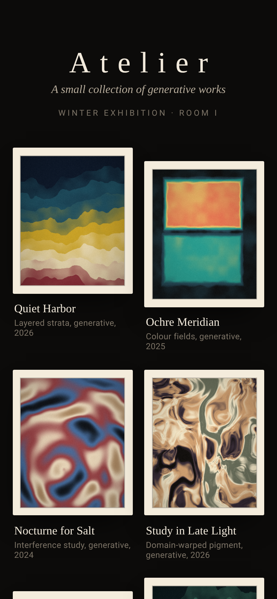
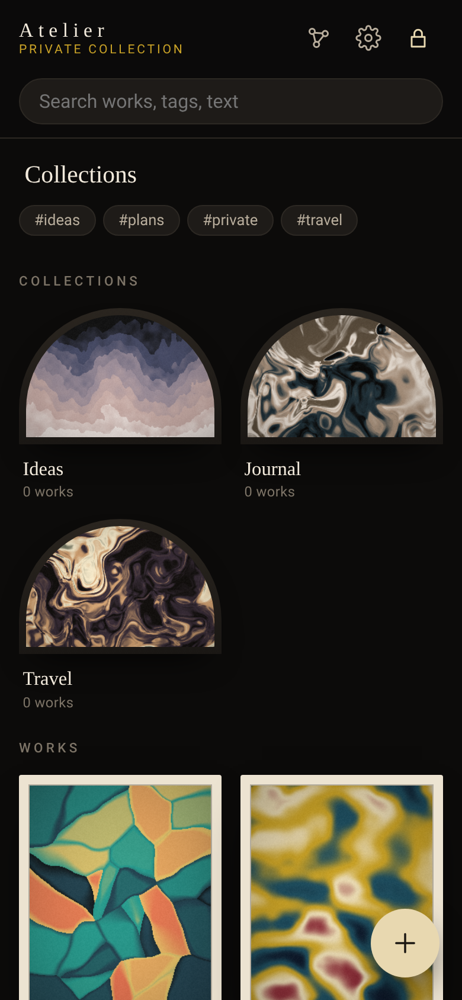
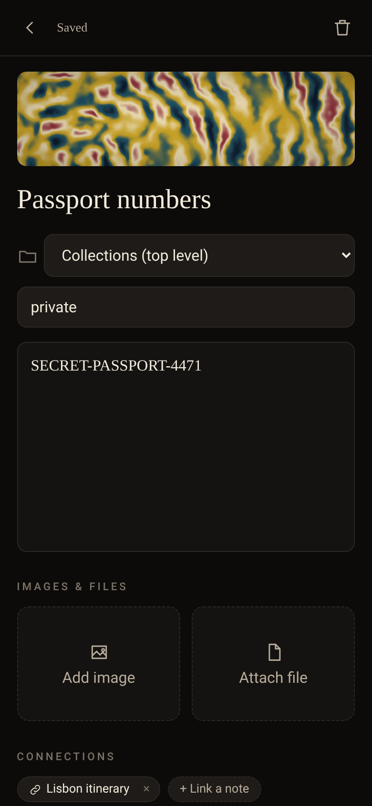
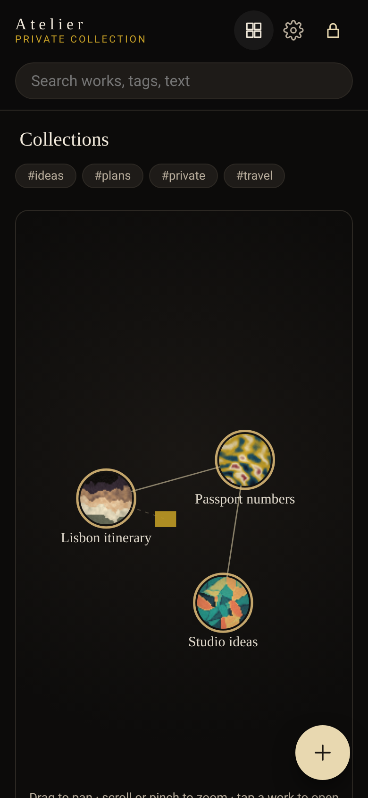

# Atelier

A private, encrypted notes app that looks like a small art gallery.

Atelier is an installable, offline-only web app (PWA). It has no server, no accounts, no analytics and no network calls. When you open it, you see a gallery of generative paintings. A secret gesture on one painting brings up the passphrase prompt. After you unlock it, your notes, images and files appear as artworks arranged in "collections" (folders). Everything is encrypted on your device before it is stored.

| Gallery (what anyone sees) | Unlocked collection | Note | Board of connections |
|---|---|---|---|
|  |  |  |  |

## Opening it: the secret gesture

1. Tap the **third** painting, *Nocturne for Salt*, to view it full screen.
2. Tap its four **corners** in clockwise order, starting top-left: **top-left → top-right → bottom-right → bottom-left**. Leave no more than 3 seconds between taps.
3. A small "Collector's key" field appears. The first time, it asks you to create a passphrase instead.

The painting shows no feedback for these taps. To change the gesture, go to **Settings → Secret gesture**: pick any painting and any 3–9 squares of a 3×3 grid over it. Swiping left or right moves between paintings. Esc or the × closes the viewer.

## Features

- **Notes** with a title, body and tags. Search and tag filters run only in memory while the app is unlocked.
- **Collections and rooms**: nested folders shown as arched gallery rooms. Their names are encrypted.
- **Images and files** attached to notes. Images are re-encoded through a canvas, which strips EXIF, GPS and camera data. Files are stored byte-for-byte. Both are encrypted.
- **Note-to-note links** with backlinks ("Referenced by").
- **Board view**: a force-directed graph of notes, their links and their attachments. You can pan, zoom, drag nodes, and tap a note to open it.
- **Notes shown as abstract art**: each note's artwork is generated from its random record ID, never from its content.
- **Auto-lock** after a configurable idle time (3 minutes by default), and whenever the app is hidden or you switch away.
- **Panic lock**: tap the lock icon or press **Esc twice**.
- **Decoy passphrase**: opens a separate, ordinary-looking collection (see below).
- **Encrypted backups** saved either as **artwork PNGs** (data hidden in the pixels) or as a plain `.atelier` file.

## Security model

**Keys**
- Passphrase → PBKDF2-SHA256 with **600,000 iterations** and a random 16-byte salt → a key-encryption key (KEK). The KEK is a non-extractable WebCrypto key.
- Each vault has a random 64-byte master secret. The KEK encrypts it into one of **4 fixed key slots**. HKDF turns the master into two **non-extractable** keys: AES-256-GCM for data and HMAC-SHA256 for IDs. The raw master bytes are zeroed immediately.
- The passphrase and raw keys are never stored. They exist only in memory while the app is unlocked.

**Data**
- Every record (notes, the vault index with folder names, tags and settings, images, files) is encrypted with **AES-256-GCM**. Each write gets a fresh random 96-bit IV, and the record ID is bound as additional authenticated data, so records can't be swapped.
- Plaintext is padded to size buckets (512 B, powers of two up to 64 KiB, then multiples of 64 KiB) to hide exact lengths.
- Storage is IndexedDB. The database is named `atelier-cache`, with stores `prefs` and `tiles`. All it holds is random-looking 32-hex IDs mapped to ciphertext.
- A strict Content-Security-Policy allows no network beyond the app's own origin. The service worker only serves the app's own files from cache.

**Locking**
- Lock drops the CryptoKeys and all decrypted notes, revokes image object URLs, clears the art cache and rebuilds the UI as the gallery.

**Decoy / deniability**
- The header always has exactly 4 slots of identical length. Unused slots are random bytes, and unlocking always tries every slot.
- Each vault finds its own index through an HMAC of its key, so nothing in storage links a record to a vault.
- At setup, filler records of realistic sizes are written, so the record count doesn't give much away.
- Only the primary vault can create a decoy, because only it knows which slots are in use. Someone in the decoy sees no option to create more vaults, and nothing in the decoy reveals that a primary exists.

**Backups**
- A backup is a full-device image (header plus every record, all already ciphertext), wrapped in another AES-GCM layer keyed from your passphrase with PBKDF2 (600k iterations) and a fresh salt. That makes the payload look uniformly random.
- Artwork export writes that payload into the 2 least-significant bits of the R, G and B channels of freshly generated paintings, saved as lossless PNGs. Leftover capacity is filled with random bits. Large backups are split across several images; import accepts them in any order.

## Limits: please read

- **Forgotten passphrase = data lost forever.** There is no recovery, reset or back door.
- **Browser storage can be wiped.** Clearing site data, uninstalling, iOS evicting storage from an unused web app, or losing the device all delete everything. **Export backups regularly.** The app asks the browser for persistent storage, but that is best effort.
- **Steganography is not magic.** It hides that a backup exists from a casual look, not from forensic analysis. The format has a fixed header, which is described in this README. Security comes from the encryption underneath. **Sending the PNGs through apps that recompress images (messaging apps, social media, some photo libraries) destroys the hidden data.** Keep them as files, for example in a cloud drive or on a USB stick.
- **Restoring a backup replaces everything** on the device, including all passphrases and vaults. It does not merge.
- **A decoy offers plausible deniability, not proof.** Someone who knows Atelier exists and how it works can suspect more slots are in use. If you replace a decoy, the old decoy's records stay behind as unreadable filler.
- **The secret gesture is camouflage, not security.** It is stored as a salted SHA-256 hash, but the passphrase is what protects your data.
- **Memory**: JavaScript can't securely erase strings. Locking drops all references, but decrypted text can linger in memory until garbage collection. A compromised device, browser extension or keylogger can read what you type.
- **Attached non-image files** (PDFs and so on) are encrypted but stored as-is, so any metadata inside them is kept. Images are re-encoded (JPEG, or PNG if they have transparency) and capped at 2560 px on the long side.
- **Mobile file pickers** briefly hide the app. Auto-lock-on-hide is paused only while a picker is open.

## Develop

```bash
npm install
npm run dev        # local dev server
npm test           # unit tests: crypto, stego/PNG, vault/decoy/backup (vitest + fake-indexeddb)
npm run build      # type-check + production build into dist/
npx playwright install chromium && npm run screenshots   # end-to-end checks + screenshots (against dist/)
npm run icons      # regenerate app icons from the same art engine
```

Stack: Vite + vanilla TypeScript with no runtime dependencies. The PNG codec, generative art, steganography and crypto (WebCrypto) are all in `src/core/`.

```
src/core/crypto.ts   PBKDF2, HKDF, AES-GCM seal/open, padding
src/core/vault.ts    key slots, vaults, notes, folders, attachments, links, decoy, gesture, backups
src/core/store.ts    IndexedDB + in-memory stores
src/core/art.ts      deterministic generative art (pure RGBA)
src/core/png.ts      minimal lossless PNG encoder/decoder
src/core/stego.ts    LSB embedding across one or more PNG artworks
src/ui/*             gallery, viewer + gesture, studio (collections), editor, board, settings, lock guard
vite.config.ts       strict CSP + generated precaching service worker
```

## Deploy

`.github/workflows/deploy.yml` runs the tests, builds the app and publishes `dist/` to GitHub Pages. It's a static app, and the data never leaves your device. On a free GitHub plan, Pages requires the repository to be **public**. Private repositories need GitHub Pro. Any static host works too.
